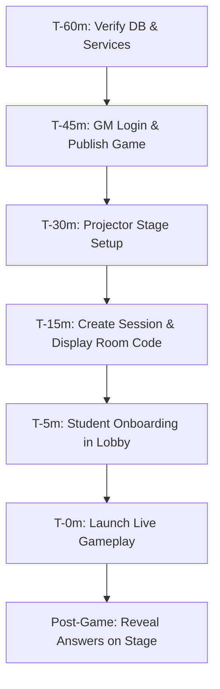

# TERMINAL — CODENEX Event Readiness & Runbook

**Target Event:** CODENEX Live Competition  
**Auditor / Event Lead:** Technical Operations & Systems Lead  
**Document Purpose:** Complete operational runbook, pre-flight checklist, and contingency protocol for the Game Master and event operators.

---

## 1. Pre-Event Verification Checklist

Execute these verification checks **T-60 minutes** before the event begins:



### 1.1 Database & Server Verification
- [ ] **PostgreSQL Service Active:** Ensure PostgreSQL is running on `localhost:5432`.
  ```powershell
  Get-Service -Name postgresql*
  ```
- [ ] **Database Backup:** Create a pre-event snapshot before making any changes:
  ```powershell
  pg_dump -U postgres -d terminal -F c -b -v -f "C:\Users\SOUMYA.B\Desktop\terminal_pre_event.dump"
  ```
- [ ] **Backend Service Running:** Ensure server is active on port 3001 (`http://localhost:3001/api/health`).
- [ ] **Frontend Client Running:** Ensure Vite client is active on port 5173 (`http://localhost:5173`).

### 1.2 Game Master Account & Publishing
- [ ] **Log in as CODENEX Game Master:**
  - URL: `http://localhost:5173/login`
  - Identifier: `codenex`
  - Verify role is `GAME_MASTER` and club is `CODENEX`.
- [ ] **Publish the Python Rapid Fire Game:**
  - Navigate to: `http://localhost:5173/workspace`
  - Open game: `PYTHON RAPID FIRE — CODE TRAP ZONE`
  - Click **Publish** button (moves status from `DRAFT` to `PUBLISHED`).
  - Verify all 10 questions show 15s timers and 100 points.

### 1.3 Projector & Display Configuration
- [ ] **Dual Monitor Display Setup:**
  - Connect laptop to venue projector via HDMI / USB-C.
  - In Windows Display Settings, choose **Extend these displays** (DO NOT duplicate, so admin controls stay private).
  - Drag browser window to Projector screen.
- [ ] **Launch Projector Stage Mode:**
  - Open URL: `http://localhost:5173/stage/[ROOM_CODE]` on the projector screen.
  - Press `F` to enter borderless browser fullscreen.
  - Test keyboard shortcuts:
    - Key `1`: Question Spotlight
    - Key `2`: Esports Leaderboard
    - Key `3`: Teams Progress
    - Key `4`: Session Stats
- [ ] **Ensure Audience Privacy:**
  - Verify no student answers or administrative action buttons appear on the projector screen.

### 1.4 Network & Intranet Accessibility
- [ ] **Find Host Laptop Local IP:**
  ```powershell
  Get-NetIPAddress -AddressFamily IPv4 | Where-Object { $_.InterfaceAlias -notlike "*Loopback*" } | Select-Object IPAddress
  ```
- [ ] **LAN Connectivity Test:**
  - Connect a test smartphone to the venue Wi-Fi network.
  - Open browser on smartphone: `http://[HOST_LOCAL_IP]:5173/join`
  - Confirm page loads and WebSocket connects.
- [ ] *(Optional Remote Access):* If campus Wi-Fi blocks peer-to-peer traffic, start a secure tunnel:
  ```bash
  cloudflared tunnel --url http://localhost:5173
  ```

---

## 2. Event Execution Runbook

### Phase 1: Lobby & Registration (T-15m to T-0m)
1. In GM Workspace, click **Host Game** on `PYTHON RAPID FIRE — CODE TRAP ZONE`.
2. A 6-character room code will be generated (e.g. `RAPID1`).
3. Open `http://localhost:5173/stage/RAPID1` on the projector. The room code and QR code will display prominently.
4. Instruct participants to navigate to `http://[IP_OR_DOMAIN]:5173/join` and enter the room code.
5. Watch the player count increment in real time on the projector.
6. If playing in teams, instruct participants to assign their team names.

### Phase 2: Active Rapid Fire (T-0m to T-10m)
1. On the GM laptop, click **Start Game**.
2. Stage Mode transitions to Question 1; student screens immediately render Question 1 with a 15-second countdown.
3. Students select an answer. Upon submission, their input locks and shows **"Answer submitted."**
4. Stage Mode displays the real-time submission percentage counter (e.g., `42 / 50 Submissions`).
5. When the 15-second timer reaches 0, the server automatically locks submissions.
6. The host clicks **Next Question** (or auto-advance continues) through all 10 questions.
7. During the round, switch Stage Mode to Spotlight 2 (Leaderboard) for 10 seconds to generate competitive excitement.

### Phase 3: Final Leaderboard & Winner Announcement (T-10m to T-15m)
1. Upon completing Question 10, the session automatically transitions to `RESULTS`.
2. Stage Mode automatically displays the **Esports Podium & Leaderboard**.
3. Confetti animations trigger on the projector.
4. Announce 1st, 2nd, and 3rd place winners.

### Phase 4: Educational Delayed Review (T-15m to T-25m)
1. On the GM laptop, click the **Reveal Answers & Explanations** button.
2. Stage Mode and student devices transition to the interactive Review Deck.
3. Walk the audience through each question:
   - Point out why distractors were tempting (e.g., Q1 power operator right-associativity).
   - Display the official explanation card.
   - Use Next/Previous controls on the host laptop to navigate questions.

---

## 3. Contingency Protocols & Emergency Procedures

| Incident | Cause | Emergency Procedure |
|---|---|---|
| **Host browser accidentally closes** | User error or crash | 1. Re-open browser to `http://localhost:5173/host/[ROOM_CODE]`.<br>2. Session state is preserved in PostgreSQL; resume immediately. |
| **Server process terminates** | System OOM or crash | 1. Restart server: `node dist/index.js` in `server/`.<br>2. Active sessions and player scores are loaded from DB; clients automatically reconnect. |
| **Student's phone screen locks or reloads** | Phone sleep / reload | 1. Student reloads `http://[HOST_IP]:5173/play`.<br>2. Client socket recovers session token, restores current active question and submission lock. |
| **Projector HDMI cable disconnects** | Hardware loose connection | 1. Reconnect cable.<br>2. Press `F` in browser window to restore fullscreen. Host controls remain safe on primary screen. |
| **Student submits after timer expiry** | Latency / clock drift | Backend strictly checks `submittedAt <= deadline`. Late submissions are rejected gracefully without breaking gameplay. |

---

## 4. Post-Event Operations

1. In the Host Dashboard, click **End Session**.
2. Click **Export Session Report** to download the CSV / JSON scoring audit sheet.
3. Perform post-event database backup:
   ```powershell
   pg_dump -U postgres -d terminal -F c -b -v -f "C:\Users\SOUMYA.B\Desktop\terminal_post_event.dump"
   ```
4. Archive session logs from `server/dist` or console output for attendance and leaderboard publication.
