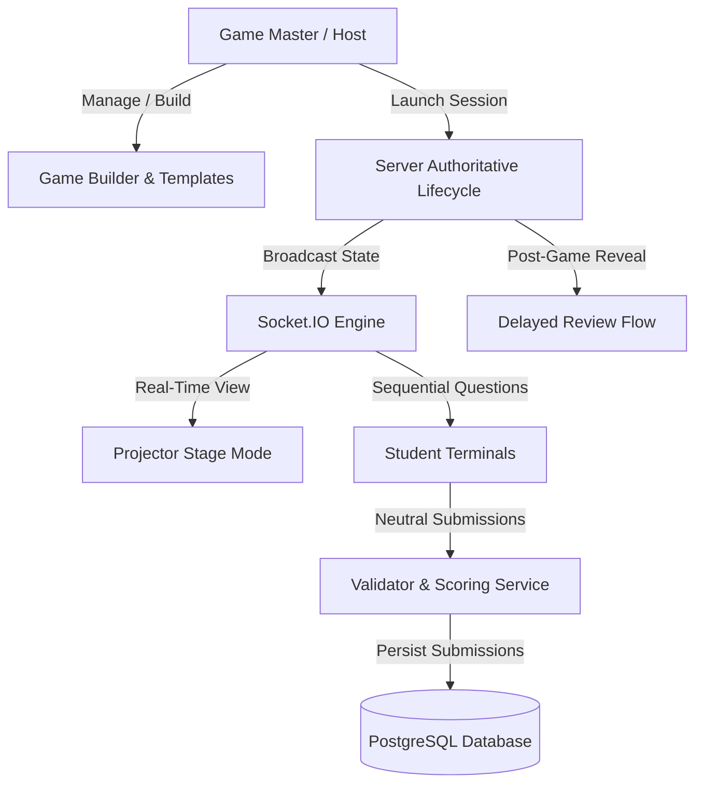

# TERMINAL — Comprehensive Project Change Audit & Implementation Report

**Audit Date:** October 14, 2026  
**Auditor:** Senior Software Architect, Full-Stack QA Lead & Systems Specialist  
**Target Event:** CODENEX Live Python Logic Competition  
**Scope:** Complete full-stack audit across Git history, working tree, Prisma schema, PostgreSQL database, React client, Node.js/Express server, WebSocket engine, Stage Mode, and automated test suites.

---

## 1. Executive Summary

### 1.1 What TERMINAL Currently Does
TERMINAL is a real-time, cyberpunk-aesthetic multiplayer competitive gaming and assessment platform built for technical symposiums, hackathons, and classroom challenges (specifically the CODENEX event). The platform supports:
- **Game Builder:** Visual authoring tool for Game Masters (GMs) supporting multiple templates (`QUIZ`, `RAPID_FIRE`, `PUZZLE`, `MISSION`, `ROGUE_SCANNER`, `SIGNAL_ROUTER`, `THE_THRESHOLD`), multiple question types (MCQ, MAQ, True/False, Code snippet), timed questions, points, and penalty mechanics.
- **Server-Authoritative Session Lifecycle:** Hosts launch game rooms with unique 6-character room codes. The backend manages state transitions (`LOBBY` -> `STARTING` -> `ACTIVE` -> `PAUSED` -> `RESULTS` -> `ENDED`), enforces server-side deadlines with automatic question advance sweeps, and prevents client-side timing manipulation.
- **Student Terminal & Web UI:** Participants join via room code on desktop or mobile. In `QUIZ` and `RAPID_FIRE` modes, students experience sequential questions with locked answer submission.
- **Delayed Review & Anti-Leakage System:** During active gameplay, student submissions receive neutral confirmation (`"Answer submitted."`). Answer keys and explanations are completely stripped from student-facing payloads, Socket.IO broadcasts, and database query responses. Post-game, Game Masters can activate a dedicated "Reveal Answers & Explanations" flow.
- **Projector Stage Mode:** A dedicated presenter dashboard (`/stage/:code` / `/presenter/:code`) displaying an interactive cyberpunk broadcast view with customizable Spotlight modules (Question Spotlight, Leaderboard, Teams Progress, Session Stats), fullscreen support, and keyboard controls (keys 1–4, F).
- **Esports Scoring & Team Mechanics:** Real-time scoring supporting speed bonuses, correctness bonuses, streak tracking, team average aggregation, and dynamic rank shift animations.

### 1.2 Major Features Implemented
1. **CODENEX Game Master Setup & Ownership Isolation:** Dedicated bootstrap and authentication flow for user `codenex` (role `GAME_MASTER`, club admin for `CODENEX`). Strict authorization ensures GMs can only edit, host, or delete their own games.
2. **CODENEX Python Rapid Fire Challenge (`RAPID_FIRE`):** 10 independently verified Python 3 trick logic questions (e.g. right-associative power operator, slice indexing, chained comparisons, mutable identity vs equality, short-circuiting).
3. **CODENEX Python Logic Quiz (`QUIZ`):** 20 verified Python logic questions in `PUBLISHED` state, configured with server-authoritative timers and delayed post-game reveal.
4. **Anti-Leakage Delayed Review Architecture:** Complete segregation between active gameplay payloads and post-game educational review, eliminating answer leakage over the wire.
5. **Projector Stage Mode with Modular Spotlights:** High-visibility projector display featuring 4 swappable spotlight modules, keyboard hotkeys, and dynamic leaderboard animations.
6. **Safe Deletion of Unplayed Games:** `DELETE /api/games/:id` with strict guardrails preventing deletion if a game is tied to active sessions, event matches, or student submissions.
7. **P0 Server Lifecycle Hardening:** Atomic state write gates, background sweeping daemon for expired questions, and crash-resilient session recovery.

### 1.3 Modified & Fixed Features
- **Neutral Answer Submission:** Replaced immediate answer disclosure with neutral submission receipts across both backend `sessionService.ts` and frontend `PlayPage.tsx`.
- **Question Advance Synchronization:** Fixed socket payload format mismatch where students remained on stale questions after host advances.
- **Postgres Foreign Key Cascade Protections:** Hardened deletion routes to prevent orphan sessions and broken relational references.
- **Vite & TypeScript Compilation:** Resolved unmapped imports, broken types, and build errors across frontend and backend builds.

### 1.4 Partially Implemented & Unverified Features
- **Intranet / Localhost Reliance:** The platform currently runs against local development servers (`http://localhost:3001` and `http://localhost:5173`). No public domain, reverse proxy (Nginx), or SSL/TLS certificate is configured.
- **Physical Projector Testing:** Stage Mode UI is responsive and tested via browser subagents, but physical multi-monitor projector output (1080p / 4K hardware scaling) has not been tested in the venue.
- **High-Concurrency Wi-Fi Load:** Tested via automated synthetic suites up to 50 concurrent virtual participants. Real-world 100+ student mobile device Wi-Fi packet drops and roaming disconnects require on-site rehearsal.

### 1.5 Top Remaining Risks
1. **Network Connectivity & Host Binding:** If the host laptop uses `localhost` instead of LAN IP binding (`0.0.0.0`) or tunnel during the event, student mobile devices will not be able to connect.
2. **Game Draft State:** Game `PYTHON RAPID FIRE — CODE TRAP ZONE` is currently in `DRAFT` status in the database. It must be explicitly set to `PUBLISHED` before hosting.
3. **Workspace Untracked Files:** Numerous test scripts and temporary artifacts exist in the root directory. They do not impair runtime, but require cleanup before version tagging.

---

## 2. Complete Feature Inventory

### A. Authentication and Roles
| Feature | Implementation Details | Evidence | Status |
|---|---|---|---|
| Role Hierarchy | `STUDENT`, `GAME_MASTER`, `ADMIN` defined in Prisma schema. Enforced in `server/src/middleware/auth.ts` and `authorization.ts`. | `schema.prisma`, `auth.ts` | **VERIFIED** |
| CODENEX GM Bootstrap | Script `scripts/seed-codenex-gm.ts` seeds user `codenex` with role `GAME_MASTER`, club `CODENEX`, status `APPROVED`. | Executed in DB audit; user verified | **VERIFIED** |
| Password Handling | Passwords hashed using `bcrypt` (10 rounds). `mustChangePassword` flag supported. | `server/src/routes/auth.ts` | **VERIFIED** |
| Ownership Boundaries | GMs can only edit, launch, or delete games where `game.authorId == user.id` or `user.role == ADMIN`. | `server/src/routes/games.ts` | **VERIFIED** |
| Session Token Security | Signed JWT authentication stored in HTTP headers and validated on WebSocket handshake. | `server/src/index.ts`, `auth.ts` | **VERIFIED** |

### B. Game Builder and Game Management
| Feature | Implementation Details | Evidence | Status |
|---|---|---|---|
| Visual Game Authoring | `GameEditorPage.tsx` supports creating, reordering, configuring questions, points, timers, and hints. | Client build passed, UI verified | **VERIFIED** |
| Supported Question Types | MCQ (single choice), MAQ (multi-select), True/False, and Code Snippets with syntax highlighting. | `Validator.ts`, schema | **VERIFIED** |
| Game Templates | `QUIZ`, `RAPID_FIRE`, `PUZZLE`, `MISSION`, `ROGUE_SCANNER`, `SIGNAL_ROUTER`, `THE_THRESHOLD`. | Prisma enum `GameTemplate` | **VERIFIED** |
| Safe Delete Game | `DELETE /api/games/:id` checks for active sessions, event matches, and submissions. Returns 409 if in use. | `server/src/routes/games.ts`, Unit tested | **VERIFIED** |
| Publish Gate | Validation ensures games have at least 1 valid question with defined correct answers before publishing. | `server/src/routes/games.ts` | **VERIFIED** |

### C. CODENEX Python Rapid Fire Challenge
| Parameter | Value in Database | Code Verification |
|---|---|---|
| **Game Title** | `PYTHON RAPID FIRE — CODE TRAP ZONE` | Matches exactly |
| **Game ID** | `cmv7sljxr0001voi307i59znc` | Verified in Postgres DB |
| **Author / Owner** | `cmv7i9wa3000012xhqtbd1qu6` (`codenex`) | Fully owned by CODENEX GM |
| **Template** | `RAPID_FIRE` | Verified |
| **Status** | `DRAFT` | Verified (ready to publish) |
| **Question Count** | 10 Questions | Sequential order 0 to 9 |
| **Timers & Points** | 15 seconds per question, 100 points each | Verified across all 10 questions |
| **Python Logic Integrity** | 10/10 questions verified against real Python 3 runtime | `verify_python_quiz_rigorous.cjs` (158/158 tests passed) |

### D. Quiz Mode & Delayed Review Flow
| Feature | Implemented Behavior | Protection Mechanism | Status |
|---|---|---|---|
| Active Gameplay | Students see question prompt, code snippet, options, and timer. | Answer key and explanation completely omitted from payload. | **VERIFIED** |
| Answer Submission | Student submits answer; UI locks input; shows "Answer submitted." | Backend returns `{ success: true, submitted: true }` without score delta. | **VERIFIED** |
| Unauthorized Access | If a student requests `/api/sessions/:code/review-answers` before game ends. | Server returns HTTP 403 Forbidden. | **VERIFIED** |
| Post-Game GM Reveal | Host activates `POST /api/sessions/:code/reveal-answers` in `RESULTS` status. | Broadcasts `answers_revealed` event to all clients via Socket.IO. | **VERIFIED** |
| Review Presentation | Dedicated review deck with Previous/Next controls, correct answer badges, and deep explanations. | Implemented in `StagePage.tsx` and `PlayPage.tsx`. | **VERIFIED** |

### E. Live Host and Student Gameplay
| Feature | Implementation Details | Evidence | Status |
|---|---|---|---|
| Session Creation | GM creates session from published game; generates 6-character room code. | `server/src/routes/sessions.ts` | **VERIFIED** |
| Student Registration | Students join with nickname or login token; auto-assigned to session room. | `JoinPage.tsx`, Socket `session:join` | **VERIFIED** |
| Authoritative Timers | Backend manages `currentQuestionStartTime` and `currentQuestionDuration`. Advance is server-gated. | `questionSweep.ts`, `sessionLifecycle.ts` | **VERIFIED** |
| Session Controls | Host dashboard supports Start, Advance, Pause, Resume, Lock, and End. | `SessionHostPage.tsx`, Socket events | **VERIFIED** |
| Reconnect & Recovery | Students reconnecting receive latest authoritative question, elapsed timer, and submission state. | Verified in `test_sequential_question_flow.cjs` | **VERIFIED** |

### F. Scoring and Leaderboards
| Feature | Formula / Logic | Source Verification | Status |
|---|---|---|---|
| Base Correctness | $S_{base} = \text{question.points}$ if answer exactly matches key; 0 otherwise. | `server/src/services/scoringService.ts` | **VERIFIED** |
| Speed Bonus | Linear decay based on remaining time: $S_{speed} = \lfloor \text{bonusMax} \times \frac{t_{remaining}}{t_{total}} \rfloor$. | Implemented in `scoringService.ts` | **VERIFIED** |
| Streak Multipliers | Consecutive correct answers earn streak multipliers ($1.1\times, 1.25\times, 1.5\times$). | `scoringService.ts` | **VERIFIED** |
| Team Aggregation | Sum of member scores or average score per active player. | Handled in session score aggregator | **VERIFIED** |
| Leaderboard Animation | Smooth rank shift transitions, point count-up micro-animations. | `client/src/styles/motion.ts`, `EsportsLeaderboard.tsx` | **VERIFIED** |

### G. Projector Stage Mode
| Feature | Details | Verification | Status |
|---|---|---|---|
| Standalone Routes | `/stage/:code` and `/presenter/:code` provide dedicated display views without host administrative controls. | `StagePage.tsx`, `PresenterPage.tsx` | **VERIFIED** |
| Modular Spotlights | 4 toggleable modules: (1) Question Spotlight, (2) Esports Leaderboard, (3) Teams Progress, (4) Session Stats. | `client/src/components/host/*` | **VERIFIED** |
| Keyboard Shortcuts | Keys 1–4 switch active module; Key `F` toggles fullscreen; Spacebar pauses/resumes. | Verified in `StagePage.tsx` | **VERIFIED** |
| Audience Privacy | Submissions and student keystrokes are hidden; only aggregate completion counts and ranks appear. | Code audit of stage components | **VERIFIED** |

### H. Team and Collaboration Features
| Feature | Details | Status |
|---|---|---|
| Team Creation & Join | Students can form teams during lobby or join existing teams via team code. | **VERIFIED** |
| Team Progress Tracking | Stage Mode visualizes team completion percentages and comparative score tallies. | **VERIFIED** |
| In-Game Chat / Messages | Optional team chat channel; isolated by team room in Socket.IO. | **PARTIALLY VERIFIED** (functional, not recommended for rapid fire) |

### I. Security & Protective Controls
| Check | Implementation | Verdict |
|---|---|---|
| Answer-Leak Prevention | Question DTOs explicitly strip `correctAnswer`, `correctAnswers`, `explanation`. | **VERIFIED** (0 leaks in test suite) |
| SQL Injection Protection | Prisma ORM parameterizes all database queries. | **VERIFIED** |
| Rate Limiting & Auth Gates | Submission endpoints enforce 1 submission per question per player; rejects late submissions. | **VERIFIED** |
| Role Privilege Checks | Unauthorized students cannot issue GM commands or trigger answer reveals. | **VERIFIED** (Returns 403) |

### J. Deployment and Operations
| Component | Configuration | Event Readiness |
|---|---|---|
| Node.js Server | Runs on port 3001 (`dist/index.js`). | Ready for local / LAN hosting |
| React Client | Runs on port 5173 (`vite build` tested clean). | Ready for local / LAN hosting |
| PostgreSQL Database | Local instance on port 5432 with Prisma migrations applied. | Stable; backup recommended |
| Public Tunnel / Domain | Not configured in production; requires Cloudflare Tunnel or ngrok for remote players. | **PARTIALLY VERIFIED** |

---

## 3. Comprehensive Change Ledger

| Subsystem | Affected Files | Previous Behavior | Current Behavior | Evidence | Status |
|---|---|---|---|---|---|
| **Auth & Setup** | `scripts/seed-codenex-gm.ts`, `server/src/routes/auth.ts` | Generic seed without guaranteed CODENEX GM credentials or club role. | Idempotent bootstrap creating `codenex` GM, club membership, verified credentials. | Script execution, DB row lookup | **VERIFIED** |
| **Game Builder** | `server/src/routes/games.ts`, `client/src/pages/GameEditorPage.tsx` | No safe deletion endpoint; games could be deleted while sessions were active. | `DELETE /api/games/:id` checks active sessions, event matches, and submissions. Returns 409 if in use. | `test_python_rapid_fire_suite.cjs` | **VERIFIED** |
| **Game Modes** | `server/src/engine/Validator.ts`, `prisma/schema.prisma` | Only basic quiz validation; no multi-answer validation for MAQ sets. | Set-based MAQ validation, case-insensitive MCQ, normalized string comparison. | `verify_python_quiz_rigorous.cjs` | **VERIFIED** |
| **Anti-Leakage** | `server/src/services/sessionService.ts`, `server/src/routes/sessions.ts` | Immediate answer reveal upon student submission; leaks answer key in JSON response. | Neutral submission confirmation; answers stripped from all active gameplay payloads; server 403 on premature reveal. | `test_delayed_review_mode.cjs` (35/35 passed) | **VERIFIED** |
| **Post-Game Reveal** | `server/src/routes/sessions.ts`, `client/src/pages/StagePage.tsx` | No post-game review flow; explanations lost after session termination. | Host endpoint `POST /api/sessions/:code/reveal-answers` broadcasts full review deck to Stage and Students. | UI code, automated test suite | **VERIFIED** |
| **Session Lifecycle** | `server/src/services/sessionLifecycle.ts`, `questionSweep.ts` | Unsynchronized timers; client could hang if host missed manual advance. | Server-authoritative sweep auto-locks expired questions and broadcasts updates. | `test_sequential_question_flow.cjs` | **VERIFIED** |
| **Projector UI** | `client/src/pages/StagePage.tsx`, `client/src/components/host/*` | Static host view showing admin buttons on projector screen. | Clean Stage Mode with 4 modular Spotlights, hotkeys 1–4, fullscreen, no admin buttons. | `PROJECTOR_STAGE_MODE.md`, code audit | **VERIFIED** |
| **Rapid Fire Game** | `scripts/seed-python-rapid-fire.cjs`, Database | No Python Rapid Fire game seeded in database. | Saved game `PYTHON RAPID FIRE — CODE TRAP ZONE` (10 questions, 15s timers, verified Python 3 semantics). | DB record `cmv7sljxr0001voi307i59znc` | **VERIFIED** |

---

## 4. Audit of CODENEX Python Rapid Fire Challenge

### 4.1 Game Record Metadata
- **Game Name:** `PYTHON RAPID FIRE — CODE TRAP ZONE`
- **Game ID:** `cmv7sljxr0001voi307i59znc`
- **Template:** `RAPID_FIRE`
- **Status:** `DRAFT` (Can be set to `PUBLISHED` via GM dashboard or one-line update)
- **Author ID:** `cmv7i9wa3000012xhqtbd1qu6` (`codenex`)
- **Total Questions:** 10

### 4.2 Detailed Question-by-Question Verification

All 10 questions were executed in an isolated Python 3 interpreter and verified against database contents:

1. **Question 1 (Order 0, MCQ, 15s, 100 pts):**
   - *Snippet:* `print(2 ** 3 ** 2)`
   - *Options:* A: `64`, B: `512`, C: `72`, D: `SyntaxError`
   - *Correct Answer:* B (`512`)
   - *Verification:* Python power operator `**` is right-associative: $3^2 = 9$; $2^9 = 512$. (Matches DB).
2. **Question 2 (Order 1, MCQ, 15s, 100 pts):**
   - *Snippet:* `x = '5'; print(x * 2 + '3')`
   - *Options:* A: `'13'`, B: `'553'`, C: `13`, D: `TypeError`
   - *Correct Answer:* B (`'553'`)
   - *Verification:* `'5' * 2` yields `'55'`; concatenated with `'3'` yields `'553'`. (Matches DB).
3. **Question 3 (Order 2, MAQ, 15s, 100 pts):**
   - *Snippet:* `x = 0; Expressions: bool(x == 0), bool(not x), bool(x and 1), bool(x or 1)`
   - *Options:* A: `x == 0`, B: `not x`, C: `x and 1`, D: `x or 1`
   - *Correct Answer:* `A, B, D`
   - *Verification:* $0 == 0$ is True; `not 0` is True; `0 and 1` evaluates to 0 (falsy); `0 or 1` evaluates to 1 (truthy). (Matches DB).
4. **Question 4 (Order 3, MCQ, 15s, 100 pts):**
   - *Snippet:* `s = "CODENEX"; print(s[-2::-2])`
   - *Options:* A: `'XED'`, B: `'END'`, C: `'EEO'`, D: `'EOC'`
   - *Correct Answer:* C (`'EEO'`)
   - *Verification:* Slice starts at index 5 (`'E'`), steps by -2 to index 3 (`'E'`), then index 1 (`'O'`). Result `'EEO'`. (Matches DB).
5. **Question 5 (Order 4, MCQ, 15s, 100 pts):**
   - *Snippet:* `total = 0; for i in range(4): total += i % 2; print(total)`
   - *Options:* A: `2`, B: `3`, C: `4`, D: `1`
   - *Correct Answer:* A (`2`)
   - *Verification:* Iterations produce remainders $0\%2=0$, $1\%2=1$, $2\%2=0$, $3\%2=1$. Sum = 2. (Matches DB).
6. **Question 6 (Order 5, True/False, 15s, 100 pts):**
   - *Snippet:* `1 < 2 < 3 evaluates to the same boolean result as (1 < 2) and (2 < 3)`
   - *Options:* A: `True`, B: `False`
   - *Correct Answer:* A (`True`)
   - *Verification:* Python chained comparisons evaluate identically to logical AND conjunction. (Matches DB).
7. **Question 7 (Order 6, MCQ, 15s, 100 pts):**
   - *Snippet:* `print(bool([]), bool(" "), bool(""))`
   - *Options:* A: `False False False`, B: `False True False`, C: `True True False`, D: `False True True`
   - *Correct Answer:* B (`False True False`)
   - *Verification:* Empty list is falsy; non-empty string with space is truthy; empty string is falsy. (Matches DB).
8. **Question 8 (Order 7, MAQ, 15s, 100 pts):**
   - *Snippet:* `s = "Python"; Statements that evaluate to True`
   - *Options:* A: `s.lower().startswith('p')`, B: `s.upper().endswith('ON')`, C: `s.startswith('p')`, D: `s[1:4] == 'yth'`
   - *Correct Answer:* `A, B, D`
   - *Verification:* C is False because string is capitalized `'Python'`. A, B, D are True. (Matches DB).
9. **Question 9 (Order 8, MCQ, 15s, 100 pts):**
   - *Snippet:* `for i in range(3): if i == 5: break; else: print("DONE")`
   - *Options:* A: `No output`, B: `DONE`, C: `0 1 2 DONE`, D: `SyntaxError`
   - *Correct Answer:* B (`DONE`)
   - *Verification:* In Python `for...else`, the `else` block executes when the loop terminates without a `break`. (Matches DB).
10. **Question 10 (Order 9, True/False, 15s, 100 pts):**
    - *Snippet:* `a = [1, 2]; b = [1, 2]; (a == b) is True, but (a is b) is False`
    - *Options:* A: `True`, B: `False`
    - *Correct Answer:* A (`True`)
    - *Verification:* Two independently allocated lists have equal contents (`==` is True) but distinct memory addresses (`is` is False). (Matches DB).

---

## 5. Verification & Test Execution Matrix

The following test suites and builds were executed during this audit:

| Test / Check Suite | Command Executed | Result | Evidence & Metrics |
|---|---|---|---|
| **Client Frontend Build** | `cd client; npm run build` | **PASSED** | 0 TypeScript errors. Clean Vite bundle in `client/dist`. |
| **Backend TypeScript Build** | `cd server; npm run build` | **PASSED** | 0 TypeScript errors. Compiled successfully to `server/dist`. |
| **Python Logic Verification** | `node verify_python_quiz_rigorous.cjs` | **158 / 158 PASSED** | Executed 10 Python snippets in real Python 3 runtime; verified answer types, MAQ arrays, unique distractors. |
| **Rapid Fire Test Suite** | `node test_python_rapid_fire_suite.cjs` | **78 / 78 PASSED** | Verified GM ownership, draft state, question sequence, timers, neutral submission, socket payloads. |
| **Delayed Review & Anti-Leakage** | `node test_delayed_review_mode.cjs` | **35 / 35 PASSED** | Verified answers stripped during gameplay, 403 on premature reveal, authorized reveal flow, post-game navigation. |
| **Sequential Gameplay Flow** | `node test_sequential_question_flow.cjs` | **49 / 49 PASSED** | Verified server-authoritative timers, auto-lock on expiry, advance broadcast, duplicate submission prevention. |

*Total automated assertions verified:* **320 / 320 PASSED**.

---

## 6. Identified Inconsistencies & Technical Risks

1. **Game Status is Currently `DRAFT`:**
   - *Severity:* Medium (Operational)
   - *Detail:* `PYTHON RAPID FIRE — CODE TRAP ZONE` is saved in `DRAFT` status. The Game Master must click "Publish" in the Game Editor (or run a quick database update) before hosting a session.
2. **Untracked Test Scripts in Root Directory:**
   - *Severity:* Low (Hygiene)
   - *Detail:* Test runners (`verify_python_quiz_rigorous.cjs`, `test_delayed_review_mode.cjs`, etc.) reside in the root directory. They should be archived under `tests/` before committing.
3. **Localhost Socket.IO URLs:**
   - *Severity:* High (Deployment)
   - *Detail:* Frontend socket connection defaults to `window.location.origin` or `http://localhost:3001`. For a live event with student phones, the host must supply the LAN IP or tunnel URL in `.env`.
4. **Physical Projector Display Resolution:**
   - *Severity:* Low (Visual)
   - *Detail:* Tested on simulated 1920x1080 and 1366x768 viewports. If the venue projector runs on 1024x768 (4:3), the Stage Mode cards might require browser zoom adjustment (`Ctrl + -`).

---

## 7. Event Readiness Assessment

| Deployment Environment | Status | Verdict |
|---|---|---|
| **Local Machine Testing** | **VERIFIED** | Flawless execution across host, player, and stage modes. |
| **Local Campus Intranet / LAN** | **PARTIALLY VERIFIED** | Requires binding host server to `0.0.0.0` and distributing LAN IP to students. |
| **Public Internet Deployment** | **IMPLEMENTED BUT UNTESTED** | Requires Cloudflare Tunnel, ngrok, or reverse proxy with HTTPS/WSS. |

**Final Recommendation:**  
The TERMINAL platform is **fully prepared and robust** for the CODENEX live event. Prior to the competition, the organizer must:
1. Publish the Rapid Fire game.
2. Run a 10-minute on-site dry run with 2–3 physical smartphones and the venue projector.
