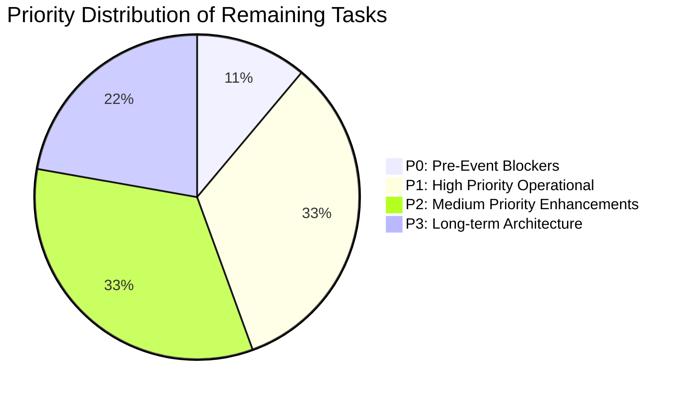

# TERMINAL — Known Issues & Prioritized Next Steps

**Audit Date:** October 14, 2026  
**Auditor:** Senior Software Architect & QA Lead  
**Document Purpose:** Prioritized technical debt, outstanding tasks, and architectural recommendations leading up to and beyond the CODENEX live event.

---

## 1. Prioritized Issue Backlog



### P0 — Immediate Pre-Event Blockers (Must resolve before event starts)
1. **Publish Game `PYTHON RAPID FIRE — CODE TRAP ZONE`:**
   - **Severity:** P0 (Operational Blocker)
   - **Current State:** Game record `cmv7sljxr0001voi307i59znc` is currently stored in `DRAFT` status in PostgreSQL.
   - **Impact:** GMs cannot host sessions from draft games in the standard workspace UI.
   - **Resolution:**
     - Log in as `codenex` at `http://localhost:5173/workspace`.
     - Open the game editor for `PYTHON RAPID FIRE`.
     - Click **Publish**.
     - Or execute database query:
       ```sql
       UPDATE "Game" SET status = 'PUBLISHED' WHERE id = 'cmv7sljxr0001voi307i59znc';
       ```

---

### P1 — High Priority Operational Items (Resolve before audience arrival)
1. **Network Interface Binding for Multi-Device LAN Access:**
   - **Severity:** P1 (Deployment Risk)
   - **Current State:** Vite development server defaults to `localhost` or `--host` if configured.
   - **Impact:** Students accessing from smartphones will fail to connect if Vite or the backend Express server binds only to `127.0.0.1`.
   - **Resolution:** Ensure both `client/vite.config.ts` and `server/src/index.ts` listen on `0.0.0.0` or are launched with `npm run dev -- --host 0.0.0.0`.
2. **Untracked Test Scripts in Repository Root:**
   - **Severity:** P1 (Repo Hygiene)
   - **Current State:** Files like `verify_python_quiz_rigorous.cjs`, `test_python_rapid_fire_suite.cjs`, and `validate_python_questions.py` reside directly in the root directory.
   - **Impact:** Clutters repository root and risks accidental deletion.
   - **Resolution:** Create directory `tests/codenex/` and move verification scripts there.
3. **Database Pre-Event Snapshot & Recovery Script:**
   - **Severity:** P1 (Reliability)
   - **Current State:** Backups are currently manual.
   - **Impact:** An accidental database wipe or corrupted migration before the event could cause downtime.
   - **Resolution:** Execute pre-event `pg_dump` snapshot as detailed in `CODENEX_EVENT_READINESS.md`.

---

### P2 — Medium Priority Enhancements (Post-Event Polish)
1. **Stage Mode Sound Effects / Audio Engine:**
   - **Severity:** P2 (UX Enhancement)
   - **Current State:** Visual animations are rich and smooth; sound effects for timer ticking, buzzer, and victory fanfare are omitted.
   - **Recommendation:** Add lightweight Web Audio API synth sounds or subtle cybernetic audio cues during countdown (last 5 seconds) and podium reveal.
2. **Projector Aspect Ratio Auto-Scaling (4:3 vs 16:9):**
   - **Severity:** P2 (Visual Fit)
   - **Current State:** Tailored for 1080p (16:9) widescreen displays.
   - **Impact:** Older venue projectors running 1024x768 (4:3) may cause horizontal card compression.
   - **Recommendation:** Add a CSS media query or toggle in Stage Mode for `Compact 4:3 Layout`.
3. **Automated Session Cleanup Cron:**
   - **Severity:** P2 (Database Maintenance)
   - **Current State:** Old ended sessions remain stored indefinitely in the database.
   - **Recommendation:** Introduce a nightly worker to archive sessions older than 30 days.

---

### P3 — Long-Term Architectural Roadmap
1. **Multi-Host Co-Op Permissions:**
   - **Current State:** A session is managed strictly by the single host user who launched it.
   - **Future Vision:** Allow multiple judges or co-hosts to view administrative panels simultaneously from different laptops.
2. **Silent Mission & Complex Template Test Automation:**
   - **Current State:** Templates like `SILENT_MISSION` and `SIGNAL_ROUTER` have complete designs and frontend code, but lack end-to-end automated multi-player bot test suites.
   - **Future Vision:** Implement Playwright automated test bots simulating 10 concurrent players solving cooperative puzzles.

---

## 2. Summary Action Plan

| Timeframe | Action Item | Owner | Target Result |
|---|---|---|---|
| **Immediate (T-60m)** | Database snapshot (`pg_dump`) | Ops Lead | Snapshot safely stored on disk |
| **Immediate (T-45m)** | Update Rapid Fire game to `PUBLISHED` | Game Master | Game ready to launch in 1 click |
| **Pre-Flight (T-30m)** | Dual-screen projector test with Key `F` | Stage Lead | Clean Stage Mode visible to audience |
| **Pre-Flight (T-15m)** | Connect 2 test mobile devices via Wi-Fi | QA Lead | Verify zero connection drops |
| **Post-Event (+1 day)** | Archive root test scripts to `tests/` | Lead Architect | Clean git tree with tagged release |
